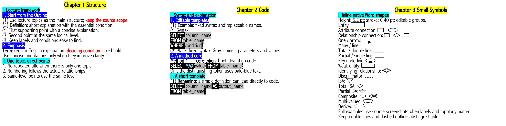

# Cheat Sheet Maker Skill

A Codex skill for producing structured, source-grounded, editable academic reference sheets in Microsoft Word.

The skill organizes lecture materials into a compact three-column format with consistent hierarchy, precise typography, semantic code highlighting, and carefully preserved diagrams. It is intended for examination reference sheets and concise revision aids.



[Editable Word example](examples/style-demo.docx) · [PDF example](examples/style-demo.pdf)

The examples demonstrate presentation only. They do not contain original course materials or a student's complete reference sheets.

## Installation

In Codex with Skill Installer available, submit:

```text
Use $skill-installer to install the skill from:
https://github.com/Catherine135/cheatsheet-maker-skill

Skill path: skills/artifact-template-cheatsheet
```

Start a new conversation after installation. If the skill is not available, restart Codex. Its display name is **Cheat Sheet Maker**, and its invocation name is `$artifact-template-cheatsheet`.

This repository contains a skill directory, not a standalone application or Word add-in. See the [OpenAI skill documentation](https://learn.chatgpt.com/docs/build-skills) for platform guidance.

## Getting Started

Provide the following information:

1. **Course and scope:** the relevant chapters or examination topics.
2. **Sources:** lecture slides or exported PDFs, with instructor transcripts if available.
3. **Additional materials:** whether tutorials, notebooks, and model answers should be included.
4. **Capacity:** the number of permitted sheets and printable sides. Two double-sided sheets allow four pages.
5. **Output:** the destination folder and required filename.

For an existing document, identify reviewed sections that must be preserved and specify whether to update the current version or create a new version.

### Example Request

```text
Use $artifact-template-cheatsheet to prepare a midterm reference sheet.

Course: [course name]
Scope: Chapters 2 and 3
Sources: [lecture folder]
Instructor transcripts: [transcript folder]
Tutorials: exclude for this version
Capacity: two double-sided A4 sheets, maximum four pages
Output: editable Word document in [destination folder]
Filename: My Course Cheatsheet v1.docx

Follow the lecture outline, cover substantive course material,
and do not introduce unsupported terminology or syntax.
```

### Revising an Existing Document

```text
Use $artifact-template-cheatsheet to revise the attached document.
Continue from the first unreviewed section and preserve earlier content.
Retain the existing style and filename prefix.
Create v2 and preserve v1.
```

## Content Principles

**Lecture-based structure.** The actual course outline determines the chapter framework. Related explanations are consolidated into logical knowledge blocks rather than copied page by page.

**Controlled scope.** Instructor transcripts supplement corresponding lecture content. Alternative syntax, deductions, and additional methods are not introduced solely because they are technically valid. Tutorials require explicit inclusion.

**Reusable syntax.** Code templates preserve the context needed for direct adaptation. Each category is presented with its own explanation and code, followed by concise keyword explanations where appropriate.

**Instructor-provided methods.** Authorized exercises retain shared schemas, question requirements, and each method actually provided by the instructor. A concise Idea precedes each solution, and distinguishing tokens receive selective emphasis.

**Accurate diagrams.** Original overview diagrams and complex source examples are retained. Small native Word symbols may supplement drawing instructions without increasing line height. Default symbol strokes are 0.40 pt, with double lines and dashed outlines kept distinguishable.

## Reference Style

- **Page layout:** A4 portrait, three columns, fixed 6 pt text line spacing, and minimal blank space.
- **English body:** Abadi MT Condensed Light, 6.5 pt; ordinary explanations remain regular weight.
- **Optional Chinese annotations:** DengXian Light, 5.5 pt, bold; used only when required by the user's language preferences. Repository documentation and examples are in English.
- **Chapter headings:** 1 pt larger than the corresponding language baseline, with yellow highlighting. Internal topics use cyan; genuine subheadings use blue with white text.
- **Circled numerals:** 5.5 pt, regular weight, implemented as reusable Word fields. Numbering follows logical relationships rather than a fixed meaning for each marker type.
- **Prose emphasis:** red bold text for decisive properties, conditions, directions, and error-prone distinctions.
- **Fixed code tokens:** bold white text on black. Replaceable names, parameters, and values use regular black text on light gray.
- **Method-specific tokens:** selective pale-blue text, retaining the underlying black or gray background.

Font files are not distributed. Accurate reproduction requires the specified fonts to be available locally; substitutions can change pagination. Formatting checks and inspection of rendered pages are required before delivery. Any unavailable verification capability must be disclosed.

## Verification and Limitations

The workflow retains a source coverage record and checks substantive content against the supplied materials. Automated checks validate document properties; they do not guarantee completeness or subject-matter accuracy.

Page limits are established for each examination. Repetition is reduced before content is omitted; font size, column count, and line spacing are not silently changed to fit a limit. Word and other rendering engines may paginate differently.

The skill does not include a workflow for publishing course materials. Any external publication requires separate user authorization. Processing of supplied files remains subject to the selected AI platform's settings and policies.

## Repository Contents

- `skills/artifact-template-cheatsheet/`: installable skill, references, minimal Word template, native symbols, and document utilities.
- `examples/`: English presentation examples, editable output, and reproduction inputs.
- [Developer Guide](docs/developer.md): manual construction, validation, and rendering instructions.
- [Design Rules](docs/rule-updates.md): the reusable conventions maintained by the skill.

This repository excludes original lecture materials, private reference documents, personal filesystem paths, and font binaries. Code, instructions, and generic templates are provided under the [MIT License](LICENSE).
